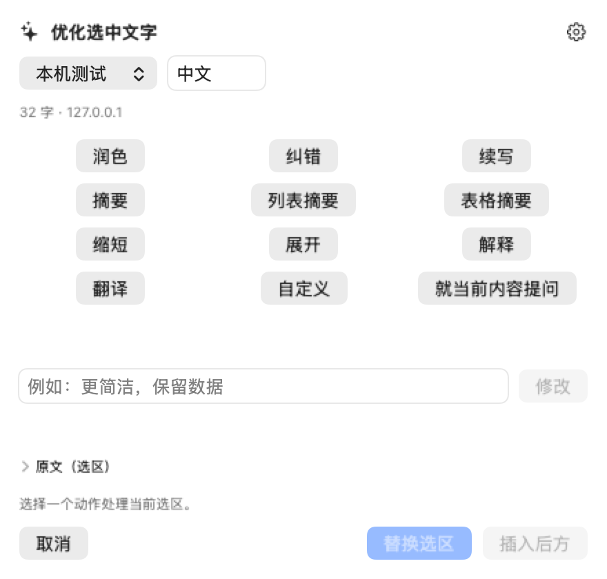
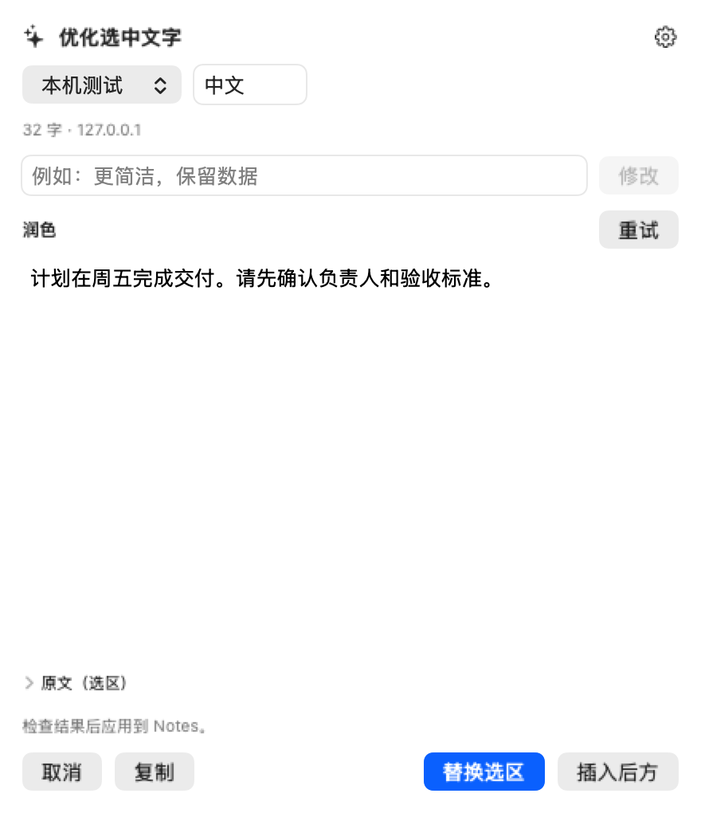

# Notes 内的 AI 编辑与统一配置

2026-10-08，当前0.3.1（下方预览图来自0.3.0，基本布局未改变）。用户要求：优化、模板和日常笔记操作尽可能在 Notes 内闭环；后台只维护配置，避免写作中跳转到另一个编辑器。

## 使用流程

1. 在 Notes 选中文字，点击浮动工具条中的 AI，或按 `⌥⌘A`；笔记底部 AI 按钮和菜单栏入口进入同一个面板。
2. 选区旁显示原生浮动面板，提供润色、纠错、摘要、翻译等已配置动作，也可直接输入修改要求。此时尚未发请求。
3. 点击动作后在同一面板展示流式结果，支持停止、重试、检查和编辑。原文可展开核对。
4. 点击替换或插入，校验笔记和选区后写回，成功后收起面板。无选区时明确按当前笔记处理，只允许插入光标后。
5. 取消不会写入。切换笔记、选区或编辑原文后，保留候选供复制，禁用旧目标的写回；关闭后在新选区重新打开。

界面是附着在 Notes 附近的原生 NSPanel，不是修改 Apple Notes 应用内部视图。打开面板不激活 AppleNotesPro 主窗口、不打开设置、不复制正文到后台编辑器。切换到其他应用会关闭并取消未应用任务；当前没有会话历史或多轮聊天。

## 后台只做配置

- 通用：启动、增强开关、权限与状态。
- 编辑工具条：项目显隐、排序与默认值。
- AI 与提示词：模型连接、Keychain 密钥、提示词动作、系统提示词与写作偏好。
- 模板：列表选择、名称/快捷词/正文维护；实际插入回到 Notes 的 slash 或模板选择面板。
- 快捷键与关于：操作说明与版本来源。

不再存在“写作助手工作台”，也没有模板后台“预览与插入”按钮。应用后台启动不自动弹配置；用户主动从菜单栏设置或重新打开已运行应用时才显示配置。旧 JSON 配置与 Keychain 引用继续复用。

## 实现与保护

`InlineAssistantModel` 持有一次捕获的内容和配置，生产请求仅由用户选择动作/提交要求触发。任务有独立 generation；取消、关闭或开始新会话使迟到响应失效。部分结果不能应用；写入开始后阻止重复应用/关闭/重建会话，失败不自动重试。

`InlineAssistantController` 使用非激活面板、选区/窗口定位和屏幕边界限制。定时检查目标是否变化；最终生成/应用前还校验 Notes 身份。面板内键盘输入不进入 Notes 的快捷键/Markdown/slash 监听链，减少输入法与快捷键干扰；实际中文输入法候选体验仍需实机验收。

模板选择和正文反链预览也复用非激活面板，设置没有操作入口。0.3.1 将面板输入占用改为独立持有，并使用一次 Notes 原生粘贴完成AI/模板写回。AI 写回仍是局部纯文本，当前不承诺 Markdown 表格自动变成 Notes 原生表格或富文本无损保留。

## 本轮证据

- 177 项测试中 176 项执行通过，1 项旧宣传截图用例跳过。
- 新增会话测试：打开不联网、只发送捕获内容、流式结果与应用、取消/关闭后迟到响应、目标变化保护、失败不重试、无连接/无捕获、键盘隔离、跨屏边界。
- 当前 AI 动作页与结果页使用真实 SwiftUI 视图和合成文本渲染，检查控件与布局；这些不是 Notes 写回实机截图。
- 实机检查了统一设置的通用、模型连接、提示词与模板分类；已不含写作工作台或模板插入入口。
- 当前系统显示 AppleNotesPro **辅助功能、完全磁盘访问未授权**，Notes 自动化已授权。AI 快捷键未打开面板，因此完整“选区→生成→应用”仍待辅助功能授权后验证。反链另外需要完全磁盘访问。没有自动修改系统授权，也没有调用真实付费模型。

预览图为合成内容的原生视图渲染：

完整构建、签名和哈希见 [验证记录](../VERIFICATION.md)。
