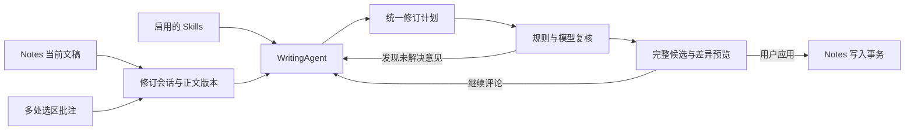

# AppleNotesPro：Skill 写作 Agent 与多处批注统一修订

> 0.4.0 已实现首版，实际范围、验收和限制见 [实现记录](WRITING-AGENT-0.4.0.md)。下文保留为设计基线，不能把所有规划项当作已实现。

2026-10-09。本文是对 0.3.9 源码与公开规范的核对，以及下一阶段设计；不是功能已实现声明。当前安装版和现有功能不因本文改变。

## 结论与产品方向

应将下一阶段定义为一个“当前文稿的修订会话”：在 AI 返回的候选稿中逐句划线并评论，也可以从 Notes 原文选句加入意见，累积十处或更多批注；选择写作 Skill 后统一生成修订稿、检查前后逻辑，再预览和应用。支持同一段中的不同句子，也支持同一篇中的不同段落。用户提到“像 Codex 的回答”这一类交互，优先按可批注的 AI 候选稿设计。

Skill、持续对话、多处批注是三个相互关联的能力。只把 SKILL.md 拼进现有 prompt，不能解决会话历史、锚点漂移、意见冲突或全篇一致性。

沿用产品定位：Swift/SwiftUI/AppKit，日常操作在 Notes 旁完成，后台仅配置模型/Skill/提示词/模板。不引入独立知识库、全文搜索、跨笔记检索，也不把应用变成另一个文档编辑器。会话草稿是本次修改任务的数据，不是知识库。

## 当前版本的真实能力

| 当前实现 | 源码依据 | 对新增需求的影响 |
| --- | --- | --- |
| 每次生成只传 system + 当前 user 内容 | `src/Quillside/AI/ModelClient.swift` 的 ModelRequestBuilder | 无完整消息历史，也无 tool-call 事件/返回结果循环 |
| “继续修改”仍基于 source，source 在 begin 时捕获 | `src/Quillside/Features/InlineAssistant/InlineAssistantModel.swift` 的 begin/run/runCustom | 上一轮候选和前几轮要求没有自动成为新一轮输入 |
| 新建/关闭面板会清空候选与会话字段 | InlineAssistantModel.begin/dismiss | 没有持久修订任务、候选版本或恢复机制 |
| 有选区时只给模型该选区，没选区才用 body | `Features/InlineAssistant/InlineAssistantController.swift` 的 present | 局部修改不自动拥有全文上下文，不能据此保证前后自洽 |
| 选区变化让现有写入快照失效 | `Workspace/SelectionTransaction.swift` 的 validateEditor/validateForWrite | 这是单次写入的重要保护，但不能直接用作允许连续选十处的会话身份 |
| 写回为一次原生粘贴，禁止覆盖 FFFC 原生对象 | `Services/NotesPasteTransaction.swift` | 已有目标校验、剪贴板保护、写后读回可复用；批量范围与富文本处理需要新的计划层 |
| Skill 包加载与批注数据类型均不存在 | 对 active src 的源码搜索 | 不应把当前提示词列表称为 Skill 系统或 Agent 内核 |

## Skill 支持范围

采用 [Agent Skills 标准](https://agentskills.io/specification)，而不是另造同名格式。最低结构为 SKILL.md（YAML frontmatter + Markdown）；references/assets/scripts 可选。宿主如何调用工具、保留状态、安排执行步骤是应用自己提供的能力。[官方集成指南](https://agentskills.io/client-implementation/adding-skills-support)

首批候选：

- [blader/humanizer](https://github.com/blader/humanizer)：英文写作规则，可作为英文 Skill。
- [op7418/Humanizer-zh](https://github.com/op7418/Humanizer-zh)：中文写作规则，更贴合目前使用场景，强调保留事实、条件、否定与作者语气。

源码、固定提交、许可和兼容细节见 [专项调研](research/WRITING-SKILLS-2026-10-09.md)。只核验了包结构与指令内容，还没有在当前 App 上评估实际改写效果。

| 首版能力 | 行为 |
| --- | --- |
| 指令 Skill | 解析 name/description/compatibility 等元数据；用户启用，按需读取完整 SKILL.md |
| 文本资源 | 按需读取 Skill 目录内的 references 和文本 assets，保留相对路径、来源与文件摘要 |
| 工具映射 | 声明所支持的原生文稿工具；无法提供的必需工具明确标为不兼容 |
| 会话固定版本 | 本次修订固定启用的 Skill 和内容摘要；文件在磁盘更新不改变运行中的规则 |
| 配置页 | 导入文件夹、启用/禁用、来源/许可/版本、加载错误与兼容情况；可显式选择共享技能目录 |

首版不宣称可直接执行任意 Skill 中的 shell、Python、Node 或网络脚本。`allowed-tools` 是声明，不是授权；一些客户端还采用不同 YAML 表示，加载器应合理兼容但不能因此扩大执行能力。是否需要脚本取决于技能正文，而不仅是有没有 scripts 文件夹。中文 Humanizer 主体为 Markdown 指导，不需要为它先引入通用脚本运行时。

Skill 规则服从本次用户批注和保留原文事实的要求；文稿中的命令样文字属于材料，不得成为工具指令。加载路径和资源量有限制，扫描发生在配置变化/进入会话时，不能放回日常按键、鼠标或选区的性能路径。

## 两种批注位置，分开实现

| 批注对象 | 原生实现 | 实现顺序 |
| --- | --- | --- |
| AI 返回的候选稿 | 将当前TextEditor升级为应用自己持有的NSTextView；使用临时文字属性/布局片段显示划线、编号和评论，锚点绑定候选版本 | 优先，直接对应“像Codex回答一样选段批注”；不依赖Notes开放评论接口 |
| Notes 原文 | 通过当前选区加入批注；跨进程显示持续划线需AX坐标和贴附浮层 | 先实现选句加入与定位，持续跨行划线经过专项实测后启用 |

两个入口共用批注集合和Agent会话。不要因为Notes没有公开评论对象，就把候选稿批注也描述为难以实现。候选稿是编辑建议，不是另一套笔记库；最终稿仍应用回Notes。

简单润色继续保持当前紧凑面板；只有用户进入批注审阅时，才展开候选稿与批注列表。新增复杂能力不能默认把每次润色都变成大窗口。

## Notes 内的交互

1. 在 AI 候选稿中选中文字，弹出“添加批注”；Notes 选区工具条也提供加入批注的入口。现有“一次润色”继续作为快捷操作。
2. 用户拖选一句话，点击批注，输入“这里太空泛，补充论据”；保存后小输入框收起，继续在 Notes 选第二处。
3. 当前笔记显示轻量的“修订 · 10 条”入口。按需展开批注列表，不同时铺开十个气泡，也不跳到设置。
4. 点击一条批注可定位原文、编辑意见、停用或删除该条。原文标记使用临时划线/轻量高亮与编号；确认前不写入正文格式。
5. 点击“整体优化”，面板明确显示“当前笔记上下文 + 10 条批注 + 本次 Skill”，用户可看到本次送入模型的范围。
6. Agent 按整篇文稿的目标生成一个候选版本，并给出各条意见的处理状态、仍存在的冲突和必要的连带修改。
7. 用户可以对候选稿继续选段评论；后续轮次基于当前候选版本和会话历史，而不是悄悄回到最初原文。
8. 确认后应用到 Notes；关闭生成面板可保留修订草稿。设计暂按“本机按笔记保留、下次继续”默认方案记录，这是可调整的产品偏好，不是已实现状态。

批注不应直接复用 Notes 永久下划线来冒充评论系统。Notes 的高亮/下划线是文本格式，随笔记保存；[官方格式说明](https://support.apple.com/en-nz/guide/notes/apd1955d3b21/mac)没有把它描述为类似 Pages 的锚定批注对象。检视本机 `/System/Applications/Notes.app/Contents/Resources/Notes.sdef`（0.3.9 调研所用环境），note 暴露 body/plaintext/identity 等属性，没有 comment/annotation 类。未找到 Notes 的公开第三方原文评论扩展点；不能因 Pages 有评论能力就假定 Notes 同样开放。

[AXBoundsForRange](https://developer.apple.com/documentation/applicationservices/kaxboundsforrangeparameterizedattribute) 可返回文字范围矩形，是原生贴附标记的基础。但接口存在不代表每个 Notes/macOS 版本可靠实现所有场景。多行划线需按可用的行范围能力分片；跨行、滚动、折叠、缩放、窗口移动、不同屏幕均必须实测。若位置无法可靠取得，保留边注列表和点选定位，不画在不确定位置。不能要求额外重建整篇编辑器来掩盖这个差异。

## Agent 内核应做什么

模型连接继续使用用户已有配置。新增一个原生 WritingAgent 模块，外部 Interface 以事件为中心：开始/恢复修订、添加/更新批注、提交要求、取消、选择候选版本、请求应用。其 Implementation 内部管理上下文、Skill、模型轮次、候选计划和核对状态；UI 不自行拼消息或循环调用 ModelClient。

默认采用有界写作循环：理解全文与意见 → 合并重复/识别冲突 → 生成整体稿 → 逐条核对 → 检查术语/数字/因果/指代/衔接 → 必要时有限次修正 → 等待用户审阅。限制步骤、时间和输出预算，支持停止；不允许无限“自我优化”。只显示阶段进度、修改说明和未解决事项，不需要把模型内部思考堆进写作界面。

内部工具首批只围绕写作：读取当前文稿版本、读取批注、激活Skill、读取Skill引用、提出修改计划、请求澄清、验证候选。模型返回建议，直接写 Notes 的能力仍留给用户触发的应用流程。

模型适配需要升级：现有四协议只处理文本结束信号；Chat tool_calls 与 Anthropic tool_use 目前会被当作非正常结束。新增消息历史、结构化提案、工具事件和对应结果适配后才能称为具有工具循环的 Agent。对不支持工具调用/结构化输出的连接，用明确的固定步骤工作流降级，不能伪造已执行工具。

## 十处批注怎样保证一起考虑

以下是合成示例：

| 位置 | 用户意见 | 统一修订时必须关联的内容 |
| --- | --- | --- |
| 开头“效率提升巨大” | 去掉夸大表达，具体一点 | 与后文真实量化结果对应，不能编造新数据 |
| 中段“30分钟缩短到10分钟” | 保留数字与条件 | 摘要、结论中的数字不能变样 |
| 结尾“完全不需要人工” | 与前面仍需复核矛盾 | 应同步调整结论，不能只在这一句换同义词 |

Agent 的一次任务输入包含同一份文稿版本、全部意见、固定的Skill、总体写作目标、受保护事实/段落和当前候选版本。输出既包含整合后的文稿，也包含每条批注的处理说明、未处理原因及修改依赖。

不能把“十个独立改写结果拼接”当作整体优化。用户单独拒绝一处修改后，也需要重新检查最终组合稿的衔接与依赖。用户意见相互冲突时显示待决定项；模型自身核对不等于形式证明，系统不能承诺每次百分之百逻辑自洽。

程序可硬性检查版本、原句命中、批注ID覆盖、重叠修改、保留字段和结构标记；语气、因果、论证完整性仍依赖模型复核和人工审阅。没有明确要求时不新增数据、经历、引用或加强结论确定程度。

## 文稿锚点和写回

建议会话数据包含：

- 稳定 noteIdentity、基线正文摘要/版本、明确的编辑范围。
- 每条批注的ID、对象类型（Notes原文/AI候选稿）、所属版本、UTF-16范围、原文引用、前后文、评论和状态。
- 启用Skill的版本/内容摘要；对话要求、候选版本、修改计划与核对结果。
- 应用记录与失败状态；运行过程的工具结果只保留必要内容。

十次改变选区不应使整个会话失效。因此“会话仍属于这篇文稿”与“现在能否在这个范围写入”必须分开：收集批注允许移动光标；真正应用时重新捕获并校验 Notes 身份、正文版本、目标范围和原生对象。

用户修改正文后，先标记锚点待重定位，旧位置划线停止显示。只在明确操作边界进行正文比对和重定位，避免重新引入每次按键读取全文。原句+前后文唯一匹配时可迁移；重复文字、重叠范围或无唯一结果时要求重新定位，不猜测。

统一修改计划先在不可变基线生成，合并重叠/相邻段落，处理相互依赖，然后预览。不能应用第一处后仍按旧偏移写第十处。执行不应由模型自由点击或操作Notes数据库。

当前写回是纯文本单次粘贴：连续纯文本范围能沿用原生Undo与写后校验。跨多个不连续范围、原生表格/图片/附件、富文本样式保留属于独立验收门槛。不得用整篇纯文本覆盖来冒充格式保真的批量修改。应先验证AX的RTF范围读取和可保留格式的编辑计划；[参数化属性文档](https://developer.apple.com/documentation/applicationservices/carbon_accessibility/parameterized_attributes?language=objc)列出RTF与属性字符串能力，但不保证Notes对所有内容实现。

分段多次写回可能需要多次Undo。只有验证一次原生操作能完整表达本次修改时，才承诺一次撤销恢复全文；否则明确呈现逐段应用，或保持预览不执行不可靠写入。任何不确定写入失败立即停止，不自动重复粘贴，不猜测整篇回滚。

## 分阶段实现与验收门槛

1. **持续修订会话**：正确使用上一候选/人工修改后的候选继续讨论；保存任务、取消/恢复、上下文预算；改变光标不会丢失意见，改变正文能发现冲突。
2. **Skills**：标准文件解析、启用/禁用、资源按需加载、中文humanizer真实样例、版本固定；不在选区热路径扫描目录。
3. **候选稿批注与整体优化**：原生NSTextView多处划线/评论、Notes选句加入意见、当前文稿上下文、冲突检查、统一稿件、逐条状态、继续评论、保护性写回。
4. **Notes原文贴附表现**：与候选稿划线分开验收；多行划线/编号、滚动和多屏定位、不可定位时的退化方式，保持0.3.9已经确认的选区响应。

前三项可作为一次完整的功能里程碑，包含AI回答内的实际划线批注；第四项先做针对 Notes AX 能力的技术验证，再决定外部原文持续划线的覆盖范围。界面首版即可提供选区→批注→定位→统一修订的完整闭环；不得把只做好了读取Skill或画线就当成整体功能完成。

关键验收：十条意见都进入同一个版本；更改第2条后第9条可被重新复核；同句重复出现不会批错；用户拒绝一处后能检测依赖；原文变动不误覆盖；中文与emoji范围正确；表格/附件不丢；关闭重启恢复策略明确；无真实授权不发送其他笔记；运行和划线不拖慢普通选择/输入。

## 本轮产出

源码核对、官方接口/Skill规范研究、第三方Skill候选与上述产品/实现方案。尚未将 Agent/Skill/批注新功能写入当前App，也没有安装第三方Skill或执行其脚本。研究基线与已发布0.3.9的验收相互独立。
