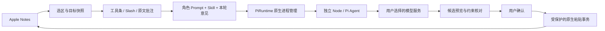

# Quillside 当前架构

SwiftUI/AppKit管理原生界面，Apple Notes保存笔记；Pi负责模型和授权适配。应用没有独立笔记库或全文搜索服务。

| 目录 | 职责 |
|---|---|
| `src/Quillside/App` | 设置、状态栏、权限、生命周期 |
| `Features` | 编辑工具条、Slash、原文批注、AI候选、反链 |
| `Services` | Accessibility快照、Notes自动化/只读数据库、局部写回 |
| `AI` | 配置、凭据兼容、请求生命周期、Pi子进程协议 |
| `Agents` / `Skills` | 角色Prompt、已批准技能与迁移 |
| `runtime/pi` | 固定版本Pi、OAuth/API Key与流式生成适配 |
| `site` | 三语言静态官网 |

每次Pi操作使用独立子进程，通过stdin/stdout JSON通信，密钥与文稿不放命令行参数。取消、超时、休眠与退出终止任务；输出完整才形成候选，模型不能自行写Notes。Pi Agent未注册shell、文件、MCP或外部工具。

新Pi凭据与用户全局Codex/Magpie/Pi目录隔离；旧连接继续读Keychain。批注与候选历史在本机持久化。写回前校验笔记身份、正文与选区，使用单次原生粘贴保留撤销，失败不扩大修改范围。

旧`ModelClient`实现仍作为历史对照与协议测试代码保留，生产生成通过PiRuntime。`WritingSession`仍提供批注复用的校验与写回，不可整体删除。`legacy/retired-features`不参与构建。

更多行为证据：[Pi迁移](../PI-ENGINE-0.7.0.md)、[原文批注](../NATIVE-ANNOTATIONS-0.5.0.md)、[批注保留](../NATIVE-LOOP-ACCEPTANCE-0.6.5.md)。
